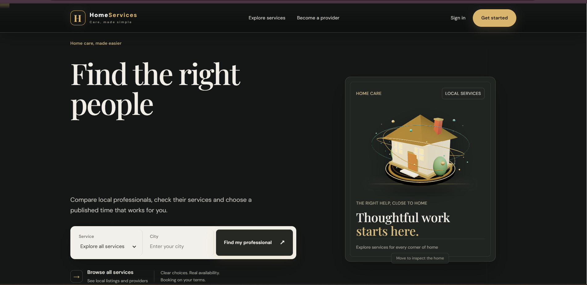

# HomeServices — Spring Boot + Thymeleaf + MariaDB

## Screenshots

### Cinematic homepage


### Customer dashboard


### Provider dashboard


A local home-services marketplace built with Java 21, Spring Boot 3.5.16, Spring MVC, Thymeleaf, Spring Security, Spring Data JPA and MariaDB. The frontend is server-rendered HTML with CSS and JavaScript; a small Three.js module adds procedural, interactive 3D showcases with local SVG fallbacks. React is intentionally not used so the current Spring MVC architecture remains simple.

## Features

- Customer and provider registration with normalized email addresses and input validation.
- Email/password authentication with BCrypt password hashing.
- Role-based page access for customers, providers and admins.
- Provider profile review workflow: `PENDING`, `APPROVED`, `REJECTED`.
- Admin dashboard with provider approvals and platform counts.
- Seeded service categories: electrician, carpenter, painter, mechanic, plumber and cleaning.
- Public service directory with city, category and text filters.
- Provider service listings with validated title, price, description and duration.
- Provider availability publishing with overlap prevention and Available/Unavailable controls.
- Customer booking requests and provider accept/reject/start/complete actions.
- Customer cancellation and booking history.
- One review per completed booking, with provider ratings/reviews.
- REST endpoints for categories, service search, availability and booking creation/cancellation.
- Pessimistic row locking during booking and booking status transitions; optimistic versioning on bookings and availability slots.
- Premium responsive black-and-gold UI with CSS motion, category-specific SVG fallbacks and procedural Three.js scenes on the homepage, service directory and service detail pages.

## Technology versions

- Java 21
- Spring Boot 3.5.16
- Spring MVC + Thymeleaf
- Embedded Apache Tomcat 10.1 (managed by Spring Boot)
- Spring Security
- Spring Data JPA / Hibernate 6.6.x (managed by Spring Boot)
- XAMPP MariaDB 10.4.32
- MariaDB Connector/J 3.5.7
- Maven

> Tomcat is the web server; MariaDB is the database. XAMPP's Apache module is not Tomcat. Keep XAMPP's MySQL/MariaDB service running while the Spring Boot app runs. XAMPP Apache is needed only for phpMyAdmin if you access it through the XAMPP dashboard.

## 1. Requirements

- JDK 21 (`java -version` and `javac -version` should both work).
- Spring Tool Suite 5.4.0.
- XAMPP with MariaDB running on port 3306 (or update the JDBC URL).
- Internet access for the first Maven dependency resolution.

## 2. Create the database

1. Open XAMPP Control Panel and start **MySQL**.
2. Open `http://localhost/phpmyadmin`.
3. Select the SQL tab and execute:

```sql
CREATE DATABASE IF NOT EXISTS homeservices
  CHARACTER SET utf8mb4
  COLLATE utf8mb4_unicode_ci;
```

Do not manually create entity tables. Hibernate creates/updates them using `spring.jpa.hibernate.ddl-auto=update`.

Default local connection in `src/main/resources/application.properties`:

- JDBC URL: `jdbc:mariadb://localhost:3306/homeservices`
- Username: `root`
- Password: blank (common XAMPP default)
- Driver: `org.mariadb.jdbc.Driver`

If your root account has a password or MariaDB uses another port, set `DB_URL`, `DB_USERNAME` and `DB_PASSWORD` as environment variables. The application properties now read those variables directly. SQL logging can be enabled with `JPA_SHOW_SQL=true` and `HIBERNATE_SQL_LOG_LEVEL=DEBUG`.

## 3. Import into STS 5.4.0

1. Extract the project ZIP to a normal development folder, for example `C:\Users\Omen\workspace\HomeServices`.
2. Open STS.
3. Choose **File → Import → Maven → Existing Maven Projects**.
4. Select the extracted folder containing `pom.xml`.
5. Click **Finish** and wait for Maven dependency downloads.
6. If Maven dependencies show errors, right-click the project → **Maven → Update Project…** → check **Force Update of Snapshots/Releases** → **OK**.

## 4. Confirm Java 21

1. Open **Window → Preferences → Java → Installed JREs**.
2. Select JDK 21 as the default (add it if missing).
3. Open **Java → Compiler** and set compliance to 21.
4. Confirm the project Java Build Path uses JavaSE-21/JDK 21.

## 5. Run the application

1. Start XAMPP MariaDB.
2. In STS, open `src/main/java/com/homeservices/HomeServicesApplication.java`.
3. Right-click → **Run As → Spring Boot App**.
4. Confirm the console ends with `Started HomeServicesApplication` and no database schema errors.
5. Open `http://localhost:8080`.

The app uses Spring Boot's embedded Tomcat. You do not need to create a separate Tomcat server in STS or deploy a WAR for local development.


## 6. Local admin account

The application bootstraps an initial administrator account using environment variables.

- Email: `admin@homeservices.local` (configurable through `ADMIN_EMAIL`)
- Password: Must be supplied through `ADMIN_PASSWORD`
- Dashboard: `http://localhost:8080/admin/dashboard`

No default admin password is stored in the project. Configure a strong password in your local environment before starting the application.

There are no default customer or provider accounts. Register them through `/register` and `/register/provider`. Provider applications require admin approval before providers can publish services.

## 7. Run automated unit tests

From a terminal in the project directory:

```bash
mvn test
```

In STS: right-click the project → **Run As → Maven test** (or Maven Build… with goal `test`).

The JUnit/Mockito tests cover registration normalization/validation, booking creation and lifecycle rules, review restrictions, service validation, provider scheduling overlap checks, and repository lock metadata. These are unit/metadata tests; they do not replace a live MariaDB integration test or browser test.

## 8. REST API

Base URL: `http://localhost:8080/api/v1`

| Method | Endpoint | Access | Purpose |
|---|---|---|---|
| GET | `/categories` | Public | List active service categories |
| GET | `/services?city=Warangal&category=Electrician&q=repair` | Public | Search approved provider listings |
| GET | `/providers/{providerId}/availability?date=2026-11-10` | Public | Get available slots for an approved provider |
| POST | `/bookings` | Customer | Create a booking |
| PATCH | `/bookings/{id}/cancel` | Customer | Cancel own pending/confirmed booking |

Example request for `POST /bookings`:

```json
{
  "serviceId": 1,
  "slotId": 1,
  "notes": "Please call before arriving."
}
```

The app uses session-based Spring Security and CSRF protection. For mutating API calls from Postman, sign in using the web login/session, retain the `XSRF-TOKEN` cookie and send its value in `X-XSRF-TOKEN`. Browser forms use Thymeleaf/Spring Security CSRF integration.

API authentication failures return HTTP 401; authenticated users without the required role receive HTTP 403. Validation errors return HTTP 400; missing resources return 404; booking/state conflicts return 409.

## 9. Build an executable JAR

In STS, right-click the project → **Run As → Maven build…** → enter `clean package` in Goals → **Run**. The executable JAR should be created at `target/homeservices-1.0.0.jar`.

## 10. Security and production notes

This project is a local-development baseline, not production-certified. Before public deployment:

- Replace the default admin credentials with strong environment-provided secrets.
- Use a supported database version and plan a Spring Boot/Hibernate upgrade strategy.
- Add Flyway or Liquibase migrations instead of relying on `ddl-auto=update`.
- Add email/phone verification, password reset, provider document review, rate limiting, audit logging, monitoring, backups and secrets management.
- Run a real MariaDB integration suite and browser end-to-end security tests.
- Review cookie security, HTTPS, CSP, CORS and CSRF settings for the chosen deployment environment.

Location search currently uses city text matching; GPS/maps and distance search are not implemented. Payment processing, customer favourites/saved addresses, email/SMS notifications and a provider earnings ledger are also outside the current scope. The procedural 3D scenes are created from Three.js geometry; they are not scanned/rigged human models. The module loads Three.js r187 from jsDelivr, and local SVG scenes remain visible when WebGL or the CDN is unavailable.

## Troubleshooting

- **Communications link failure:** Start XAMPP MariaDB and verify port 3306.
- **Access denied for root:** Set `spring.datasource.password` to the actual MariaDB password.
- **Unknown database homeservices:** Run the SQL in section 2.
- **Java version/compiler error:** Confirm STS uses JDK 21, not just a separate terminal JDK.
- **Maven dependency errors:** Check internet access and use Maven Update Project.
- **Port 8080 already in use:** Change `server.port` in `application.properties`.


## Browser screenshot follow-up fix

The app JavaScript and progressive Three.js module are loaded inside the shared footer fragment (not after it), so rendered pages receive both scripts. Bootstrap is loaded before the custom stylesheet, and the empty alerts wrapper is suppressed to avoid a blank gap under the header. If an older page is still open, hard refresh with `Ctrl + F5`.


## Service-detail experience update

The service-detail page now adapts its heading, introduction and pre-visit preparation guide to the selected category (Electrician, Plumber, Carpenter, Painter, Mechanic or Cleaning). The directory listing grid also centers compact result sets. See `SERVICE-EXPERIENCE-NOTES.md` for the implementation and verification details.

## Cinematic homepage experience

The homepage now includes a cinematic hero composition, ambient lighting layers, an enhanced procedural 3D home showcase, contextual pointer interactions and responsive motion. See `CINEMATIC-EXPERIENCE-UPGRADE.md` for the exact scope, safeguards and verification notes.
